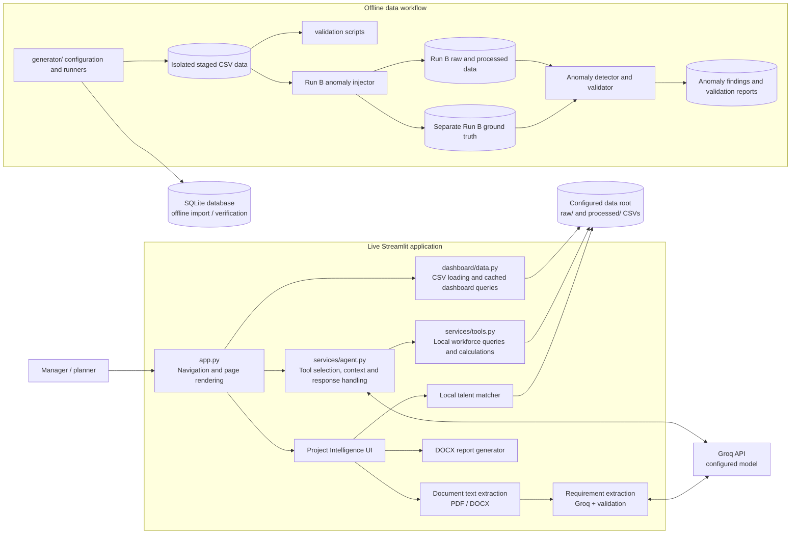

# WorkForceIQ-Agent High-Level Design

## 1. Project overview

WorkForceIQ-Agent is a Streamlit workforce-intelligence and planning application. It presents workforce demand, skill availability, talent and strategy views; provides a Groq-backed natural-language assistant; and includes Project Intelligence for reviewing project requirements against local workforce records. The application is a decision-support tool: its matching and strategy workflows report candidates or simulated outcomes and do not allocate employees or change workforce records.

The live application reads raw and processed CSV datasets through a shared configurable data root. Generation, database seeding/import, and validation are separate offline workflows.

## 2. Architecture

The live app’s normal workforce queries use CSVs. The SQLite database is created and checked by offline generation/import workflows; it is not the query store used by the dashboard or AI workforce tools.

## 3. Major components

| Component | Responsibility |
|---|---|
| `app.py` | Configures the Streamlit app, loads `.env`, defines navigation and renders the existing dashboard pages, AI Assistant and Project Intelligence page. |
| `dashboard/data.py` | Resolves the shared data root; loads, caches and reads CSVs; exposes dashboard query wrappers for shortage, talent and strategy views. |
| `dashboard/components.py` | Shared presentation helpers for headers, metrics, sections, tables and empty states. |
| `services/agent.py` | Defines four workforce tool schemas and dispatch, builds bounded conversation context, applies tool-call limits, compacts tool evidence and formats/falls back to local results where appropriate. |
| `services/tools.py` | Performs workforce search, skill-shortage analysis, talent lookup and strategy comparisons in Python over the configured raw/processed CSVs. |
| `services/llm_service.py` | Creates a Groq client using `GROQ_API_KEY`; its simple response helper uses the configured `GROQ_MODEL`. |
| `features/project_intelligence/` | Extracts document text, parses and validates requirements, matches candidates locally, and produces a management DOCX report. |
| `generator/` | Defines deterministic seed, reference date and data-root configuration; runs staged data generation, processing, database validation and Run B anomaly injection. |
| `validation/` | Checks generated workforce data and independently validates Run B anomaly evidence against separate ground truth. |
| `database/` | Defines the SQLite schema and imports/verifies generated CSV data in offline workflows. |

## 4. AI Assistant request flow

1. The user submits a question in the AI Assistant page in `app.py`.
2. The UI passes the current question and a bounded recent context to `services.agent.run_agent()`; it does not submit the full visible conversation transcript.
3. The agent sends the prompt, system instructions and registered tool schemas to Groq. Groq returns either a natural-language answer or a workforce-tool call.
4. `services.agent` dispatches registered calls to Python functions in `services.tools`. Those functions read the configured CSV data and calculate/filter locally. The registered tools are `analyze_skill_shortage`, `find_internal_talent`, `find_employees_by_skills` and `compare_workforce_strategies`.
5. Tool results are bounded/compacted for subsequent model reasoning. Employee search and employee-count responses also have deterministic Python formatting/fallback paths so records and counts are grounded in tool results.
6. The UI displays the answer. Strategy comparison is simulated and read-only; it does not create assignments.

The complete workforce files remain local to Python, but compact tool evidence (which can include a bounded set of employee results) may be included in the Groq conversation so the model can explain verified results. No claim is made that all employee rows are sent to Groq.

## 5. Dashboard data flow

Dashboard pages call `dashboard.data` helpers. The helpers resolve `WORKFORCEIQ_DATA_ROOT`, read from `raw/` or `processed/`, and cache selected loads for a short period. Dashboard views and the AI Assistant workforce tools therefore use the same configured data root. When the setting is absent, the resolver defaults to the repository’s `data/` directory.

The local application configuration selects the staged Run B package’s `data/` directory through `WORKFORCEIQ_DATA_ROOT`. The concrete local filesystem path is intentionally omitted from this document.

## 6. Data generation and validation

`generator/config.py` defines seed `20261022`, reference date `2026-11-11`, and an inclusive 12-month demand horizon ending `2027-11-10`. `generator/generate_all.py` runs the base generation and processing steps into new, isolated staging directories, validates staged CSVs, creates and verifies a staged SQLite database, and records output counts and checksums in a run manifest. It refuses to reuse existing stage directories and does not promote outputs into the live data root.

The Run B-only workflow in `generator/run_b_anomalies.py` starts from staged data and injects four controlled anomaly cases. Its output keeps `ground_truth/anomaly_ground_truth.csv` separate from `data/raw/` and `data/processed/`; it also includes reports, a staged database and a run manifest. `validation/validate_data.py` validates data and derived outputs. `validation/validate_anomalies.py` checks the four labels against injected values and independently recomputed detections. These are offline workflows; they are not invoked for every live dashboard request.

The intended Run B package is located under `data/staging/phase12_run_b_anomalies_20261112_repro_01/`. Its `data/` child is selected for live application reads; the separate ground-truth and validation artifacts remain outside the workforce CSV input directories.

## 7. Project Intelligence workflow

1. A manager uploads a PDF or DOCX in `features/project_intelligence/ui.py`.
2. `document_extractor.py` extracts and normalizes text locally using the file-specific PDF/DOCX parser.
3. `requirement_extractor.py` sends the extracted project document text to Groq for structured requirement extraction. It does not send employee records for this step. Python validates the returned project dates, skill names, proficiency, headcount and optional hours. Manual entry is also available.
4. The manager reviews and edits the requirements. Matching is blocked until validation succeeds and the manager explicitly confirms them.
5. `talent_matcher.py` reads local workforce data and performs employee qualification, candidate matching and weekly capacity calculations locally in Python. Employee records are not sent to Groq for matching. It is read-only and reports proposed candidates, gaps, training candidates, stale/excluded skills and hiring recommendations.
6. `report_generator.py` builds a DOCX from the actual matching result. The UI provides it as a download.

## 8. Technology stack

- Python
- Streamlit
- pandas for CSV data handling
- Groq Python SDK for language-model calls
- `python-dotenv` for local environment loading
- `pypdf` and `python-docx` for PDF/DOCX document handling and report generation
- SQLite for the offline generated/imported workforce database
- pytest for automated tests
- Mermaid for the architecture diagram in this document

No LangChain, LangGraph, vector database, embeddings service or separate application API is used by the inspected implementation.

## 9. Configuration and secrets

| Variable | Purpose |
|---|---|
| `WORKFORCEIQ_DATA_ROOT` | Selects the directory containing `raw/` and `processed/`; otherwise the application defaults to the project `data/` directory. |
| `GROQ_API_KEY` | Authenticates the Groq client. The value must remain secret and is not documented here. |
| `GROQ_MODEL` | Selects the model used by the AI Assistant and requirement extraction. |
| `WORKFORCEIQ_BASELINE_DATA_ROOT` | Optional offline generator baseline input. |
| `WORKFORCEIQ_DATABASE_PATH` | Optional database path used by database generation/import workflows. |
| `WORKFORCEIQ_GROUND_TRUTH_PATH`, `WORKFORCEIQ_PRE_INJECTION_FINDINGS_PATH`, `WORKFORCEIQ_ANOMALY_DETECTIONS_PATH` | Explicit inputs required when running the standalone anomaly validator. |

`app.py` and `services/llm_service.py` call `load_dotenv()`. `WORKFORCEIQ_DATA_ROOT` is environment-specific: configure it separately on each developer machine or deployment to point to that environment's dataset directory. The current local selection is not a portable path or deployment default. Do not commit or print `.env` values; `.env` is Git-ignored in the current project.

## 10. Deployment overview

### Current implementation

The verified runtime is a local Streamlit application launched with Streamlit’s CLI. It reads CSV data from the configured local data root and calls Groq over the SDK when model-backed features are used. The staged Run B outputs, SQLite database, ground truth and validation reports are files. No current cloud deployment pipeline or AWS runtime configuration was verified in the inspected code.

### Proposed AWS deployment (not implemented)

An AWS deployment would require a separate deployment design and implementation. A possible future setup could host the Streamlit process on a managed compute service, provide workforce files through an appropriately secured storage mount, and store Groq credentials in a managed secret store. Network access, identity/access controls, employee-data protections, backup, monitoring and multi-user session behavior would need explicit design and approval. These are proposals only; the project does not currently provision or use those AWS services.

## 11. Verification boundaries

This HLD describes the code and configuration inspected in the repository. It does not specify production availability, authentication, authorization, concurrent-user isolation, AWS infrastructure, or operational service-level objectives because those were not verified as implemented.
